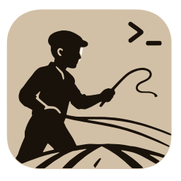
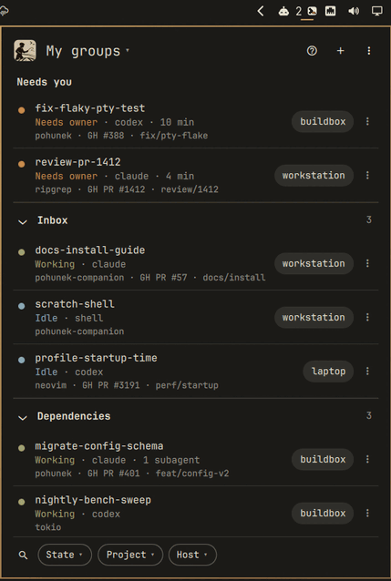
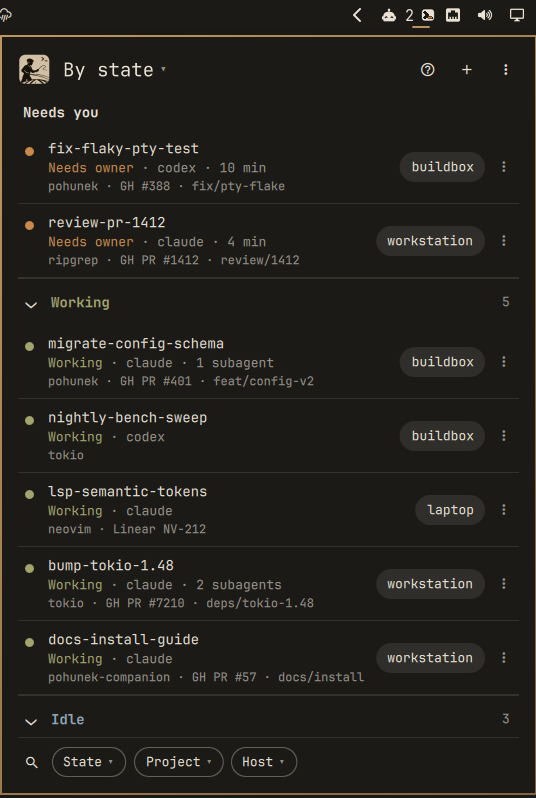
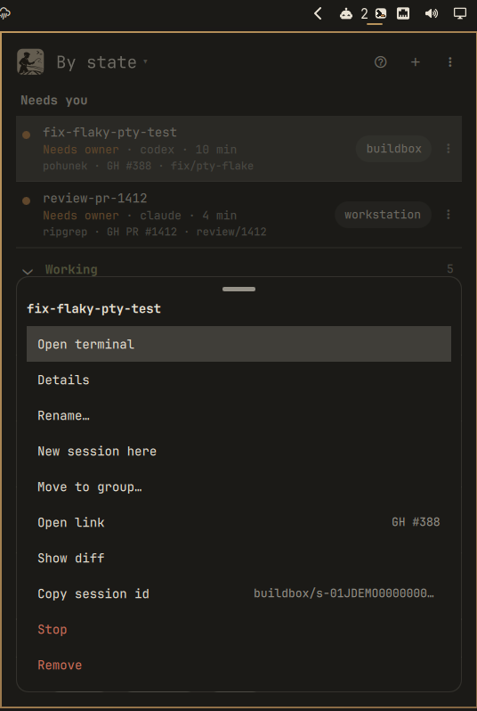
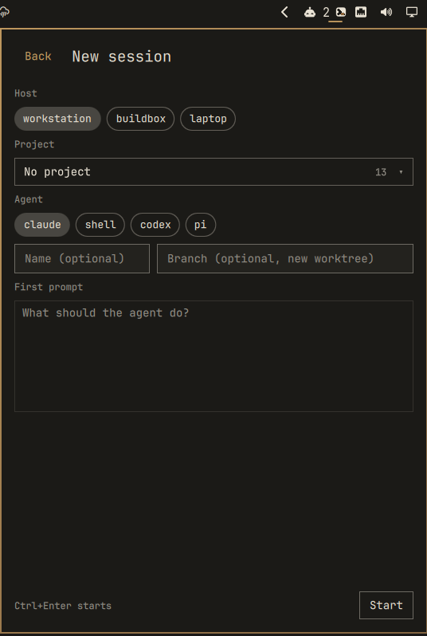
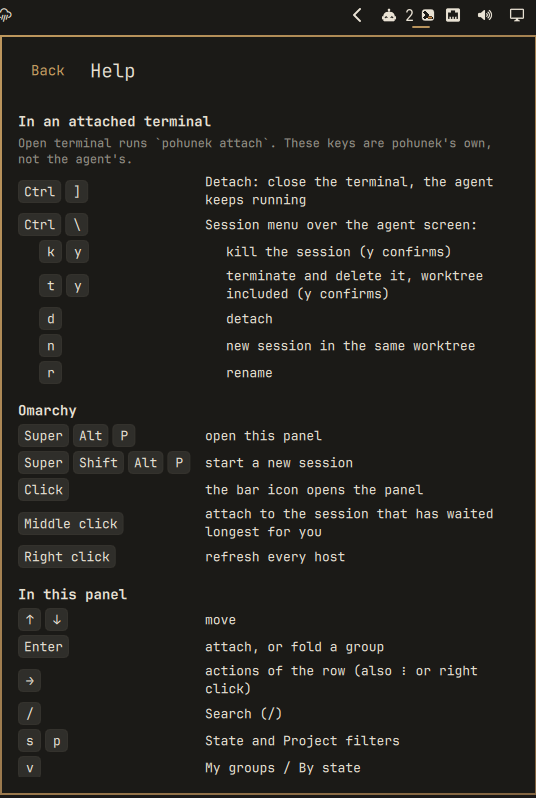
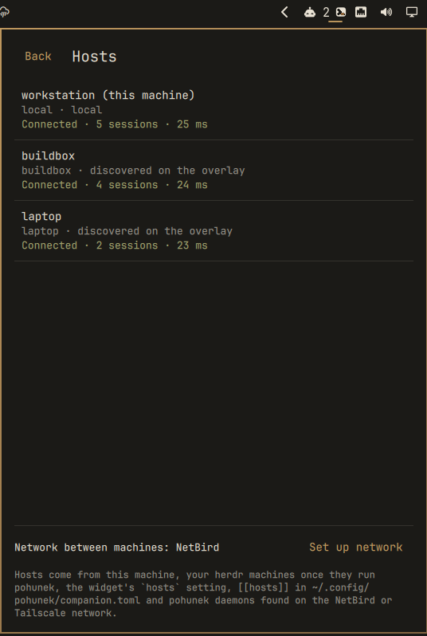
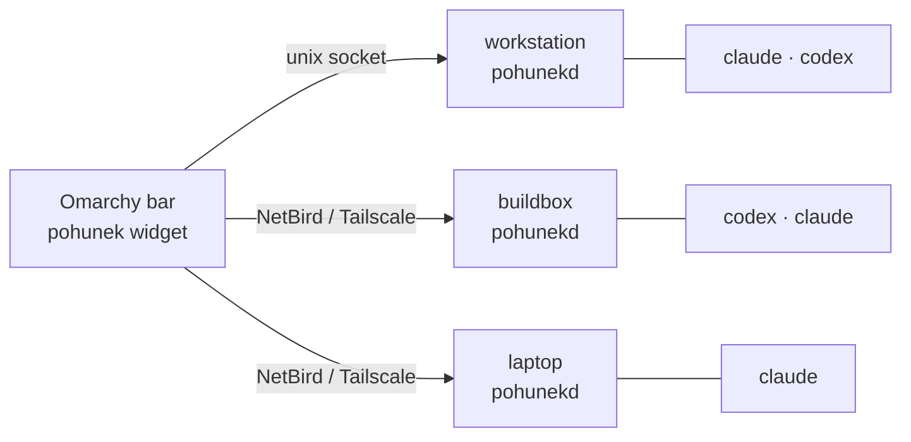

<p align="center">
  
</p>

<h1 align="center">pohunek for Omarchy</h1>

<p align="center">
  <b>Every coding agent on every machine, one keypress away in your Omarchy bar.</b><br/>
  Who is working, who is stuck waiting for you, and a real terminal on any of them in one click.
</p>

<p align="center">
  <a href="https://github.com/pohunekd/omarchy/actions/workflows/ci.yml"></a>
  <a href="LICENSE"></a>
  <a href="https://omarchy.org"></a>
  <a href="https://pohunek.dev"></a>
  
</p>

<p align="center">
  
</p>

```bash
omarchy plugin add https://github.com/pohunekd/omarchy --enable
```

That is the whole install. No pohunek on the machine yet? The panel offers
**Install pohunek**: it fetches the latest release, verifies it, shows what
will be written where, and asks once.

---

## Why

You run Claude Code in one terminal, Codex on the build box, another agent on
the laptop. One of them has been waiting ten minutes for you to approve a
command and you have no idea which. [pohunek](https://pohunek.dev) keeps every
agent session alive in a durable terminal on its own machine and knows when one
needs you. This widget puts all of it in the bar you already look at:

- **🟠 Needs you, first.** Sessions blocked on an approval or a question sit on
  top of every view, from every host, oldest wait first. The bar icon turns amber
  and counts them. A desktop notification pops up; **click it and you are in that
  session's terminal.**
- **🖥 Every machine, one list.** This machine, your other Omarchy machines and
  any pohunek daemon on your **NetBird** or **Tailscale** network, side by side,
  each row with its host chip. A machine that drops off keeps its rows, dimmed.
- **⌨ A real terminal, one click away.** Enter or a click attaches
  (`pohunek attach`); `Ctrl+]` detaches and the agent keeps working.
- **🗂 Your groups, everywhere.** Groups live in the session's
  `companion.group` metadata, so they are the same groups the pohunek desktop and
  Android companions show.
- **🚀 New sessions without the CLI.** Pick a host, a project and an agent (with
  fuzzy search when the lists get long), write the first prompt, Ctrl+Enter.

## A tour

| | | |
|:-:|:-:|:-:|
|  |  |  |
| **My groups.** Needs you on top, then Inbox and your own groups. Each row: state, agent, project, Work link (`GH PR #1412`), branch, host. | **By state.** Needs you, Working, Idle, Runtime problem. Ended sessions stay hidden until you pick them. | **Actions** (⋮, right click or →): open terminal, details, rename, new session here, move to group, open link, diff, stop, remove, resume. |
|  |  |  |
| **New session.** Host, project, agent, name, branch (a fresh worktree), first prompt. Long lists turn into a fuzzy search select. | **Help** (`?`). Every key in the panel and, most importantly, the ones inside an attached terminal. | **Hosts.** Every pohunek daemon you can reach, the network that carries them, and your Omarchy machines that do not run pohunek yet. |

### The bar icon


The pohunek plate with its `>_` prompt cut out. Only the cursor carries the state:

| Cursor | Means |
|---|---|
| 🟠 amber | a session needs you (the number beside it says how many) |
| 🔴 red | a runtime problem (a worker conflict; open Details) |
| 🟢 green | agents are working |
| cut out | all quiet |

Click opens the panel. **Middle click jumps straight into the session that has
waited longest for you.** Right click refreshes every host.

## Controls

### Omarchy

| Keys | Does |
|---|---|
| <kbd>Super</kbd> <kbd>Alt</kbd> <kbd>P</kbd> | open the pohunek panel |
| <kbd>Super</kbd> <kbd>Shift</kbd> <kbd>Alt</kbd> <kbd>P</kbd> | start a new session |

Add both with one click: **Help → Add these shortcuts to Hyprland**, or run
`tools/add-shortcuts`. It refuses keys that are already taken, backs up
`bindings.lua` and checks Hyprland for config errors.

### Inside an attached terminal

These are pohunek's keys, not the agent's. Most people never find them, so here
they are:

| Keys | Does |
|---|---|
| <kbd>Ctrl</kbd> <kbd>]</kbd> | **detach**: close the terminal, the agent keeps running |
| <kbd>Ctrl</kbd> <kbd>\\</kbd> | **session menu** over the agent screen |
| &nbsp;&nbsp;then <kbd>k</kbd> <kbd>y</kbd> | kill the session |
| &nbsp;&nbsp;then <kbd>t</kbd> <kbd>y</kbd> | terminate and delete it, worktree included |
| &nbsp;&nbsp;then <kbd>d</kbd> | detach |
| &nbsp;&nbsp;then <kbd>n</kbd> | new session in the same worktree |
| &nbsp;&nbsp;then <kbd>r</kbd> | rename |

### In the panel

| Keys | Does | | Keys | Does |
|---|---|---|---|---|
| <kbd>↑</kbd> <kbd>↓</kbd> | move | | <kbd>/</kbd> | search every host |
| <kbd>Enter</kbd> | attach, or fold a group | | <kbd>s</kbd> <kbd>p</kbd> | State / Project filter |
| <kbd>→</kbd> | row actions | | <kbd>v</kbd> | My groups ⇄ By state |
| <kbd>n</kbd> | new session | | <kbd>c</kbd> | clear filters |
| <kbd>i</kbd> <kbd>d</kbd> <kbd>o</kbd> | details, diff, open Work link | | <kbd>H</kbd> | hosts |
| <kbd>e</kbd> <kbd>g</kbd> | rename, move to group | | <kbd>r</kbd> | refresh |
| <kbd>?</kbd> | help | | <kbd>Esc</kbd> | back, close |

Everything works with the mouse as well.

## Your machines: NetBird and Tailscale

pohunek has no server and no cloud. Each machine runs its own daemon, and the
machines talk directly over your **overlay network**: **NetBird** (pohunek's
default) or **Tailscale** (built into Omarchy, with its own bar widget and
Taildrop). Your agents never leave machines you own.



| | NetBird | Tailscale |
|---|---|---|
| pohunek | default, nothing to configure | `providers = ["tailscale"]` in `~/.config/pohunek/overlays.toml` |
| Omarchy | AUR `netbird-bin` | `omarchy install service tailscale` (+ bar widget, Taildrop) |
| Self-hosted | NetBird management server | Headscale |
| Join | `netbird up --management-url …` | `sudo tailscale up` |

**Set it up in one go:** Hosts → **Set up network** (or `tools/setup-network`)
asks NetBird or Tailscale, installs the client, joins the network, writes
`overlays.toml` and restarts the daemon. Live sessions keep running.

### Roll it out to every machine

Omarchy keeps your machines in the **herdr** registry (`herdr machine add`),
the same list Omarchy's theme sync uses. The Hosts page lists the ones that do
not run pohunek yet, each with **Install there**. Or from a terminal:

```bash
tools/distribute               # every enabled herdr machine
tools/distribute laptop me@box # or these SSH targets
```

On each machine, over SSH, it copies your overlay choice, installs or updates
this widget, and installs pohunek. Joining the network needs a login there, so
it tells you where to run `tools/setup-network`. New hosts show up in the bar by
themselves: the widget re-probes the network every ten minutes.

## Configuration

`omarchy bar set pohunek.sessions <key> <value>`:

| Key | Default | |
|---|---|---|
| `refreshIntervalSec` | `5` | polling interval (2 s while the panel is open) |
| `discover` | `true` | follow every pohunek daemon found on the overlay |
| `hosts` | `""` | extra hosts, comma separated |
| `idleThresholdSec` | `300` | an idle agent counts as Idle only after this |
| `desktopNotifications` | `true` | notify when a session needs you |
| `command` | `pohunek` | the pohunek CLI |

Already using the pohunek desktop companion? Its `~/.config/pohunek/companion.toml`
`[[hosts]]` and `tray.idle_threshold_secs` are read too.

IPC for your own bindings: `omarchy-shell pohunek.sessions toggle | newSession | page <list|state|help|hosts|new|actions> | refresh | status | needs`.

## Safe by design

- **Reads first.** The list comes from `pohunek session list --json` and
  `notifications list --unread --json`; nothing changes a session until you
  pick an action, and stop/remove ask first.
- **Plain text only.** Session names, prompts and notification text are untrusted:
  bounded, stripped of control and bidi characters, never rendered as markup.
- **No shell strings.** Every command is an argv array. Only ids matching the
  pohunek session-id shape and validated SSH targets ever reach one; the
  notification click uses Omarchy's `--exec`, never a string.
- **Verified installs.** `tools/install-pohunek` checks the release SHA-256 and,
  when `gh` is signed in, its GitHub build attestation, then hands over to the
  release's own installer, which verifies its MANIFEST. Agent hooks are offered,
  never installed silently.

## Troubleshooting

| You see | Try |
|---|---|
| dimmed icon, "not installed" | panel → **Install pohunek** |
| dimmed icon, "not reachable" | panel → **Run pohunek doctor**, or `pohunek service status` |
| a host is missing | Hosts → **Set up network**; every machine must use the same overlay |
| a host's rows are dimmed | it dropped off the network; its last rows stay until it is back |
| an idle agent shows Working | it is idle for less than `idleThresholdSec`, or has subagents running |

## Development

```bash
git clone https://github.com/pohunekd/omarchy ~/.config/omarchy/plugins/pohunek.sessions
omarchy bar set pohunek.sessions command ~/.config/omarchy/plugins/pohunek.sessions/tools/demo-pohunek   # synthetic sessions
node tests/model.test.js       # every decision: owner states, groups, filters, fuzzy search
python3 tests/qml_check.py     # loads the real widget offscreen in Quickshell, 39 checks
omarchy restart shell          # pick up QML changes
scripts/gates                  # every check CI runs, one exit code per gate
```

Contributors and agents start at [AGENTS.md](AGENTS.md); releases are described
in [docs/releasing.md](docs/releasing.md).

| File | Role |
|---|---|
| `fetch.py` | asks every host at once, keeps only what is rendered |
| `Model.js` | every decision, pure and tested |
| `Service.qml` | polling, actions through the pohunek CLI |
| `Panel.qml` | the bar icon and the panel |
| `tools/` | install, network, distribute, shortcuts, demo |
| `i18n/` | English and Czech; add a language with one JSON file |

## Credits

Built on [pohunek](https://github.com/zajca/pohunek) and modelled on its
[desktop and Android companions](https://pohunek.dev/surfaces/), for
[Omarchy](https://omarchy.org). MIT licensed; the logo comes from the pohunek
project (see `assets/NOTICE`).
